# Home and Library: one coherent interface

Status: **implemented in source (2026-10-18, AVR-429). Defaults selected under delegated owner judgment; not deployed or physically accepted.**

A visible pass over Home and Library in the approved console direction
([product brief](../AVRANA-UX-UI-PRODUCT-BRIEF.md)), using Material 3 as a reference for how a
component set hangs together: one way to show what is chosen, named type roles, one notice
pattern, sheets that behave alike. The Party look is kept: the monochrome shell, the smoky
material, Atomic Purple only as the tint of a chosen thing, one radius. The findings it answers
are in the Party UX audit (pull request 106 of this repository).

## See it

```sh
python -m avrana.web.devserver --port 8180 --party --test-controls
```

Open <http://127.0.0.1:8180/party/>. The games are the dev server's catalog and the Party is
memory-only: **fixture data**. Open the page in a second private window to add a person.
States: stop the server to see Reconnecting and then "This phone lost the Party box"; search for
`zzzz` in the Library for the empty state. `capture.mjs` in this folder produces every state
below, from `main` (before) and from this branch (after), with invented people.

The screenshots below record the original 2026-10-11 comparison. The 2026-10-18 reconciliation
keeps current typography names and easing, Party-owned chat, and keyboard viewport handling.
The five defaults below use the owner's delegated judgment; the raised-surface palette remains open.

## Before and after

| | Before | After |
|---|---|---|
| Home, phone | 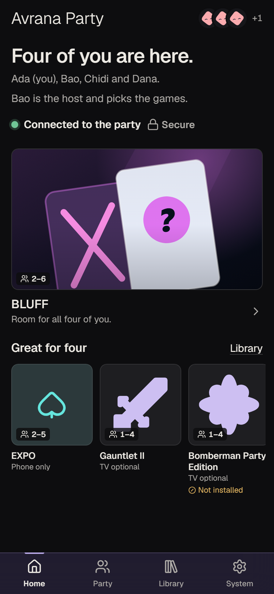 | 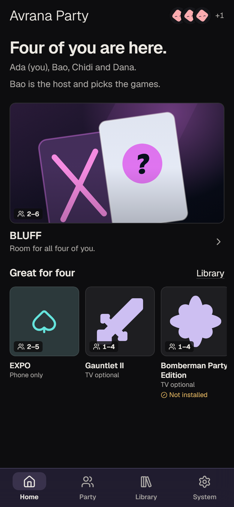 |
| Library, phone | 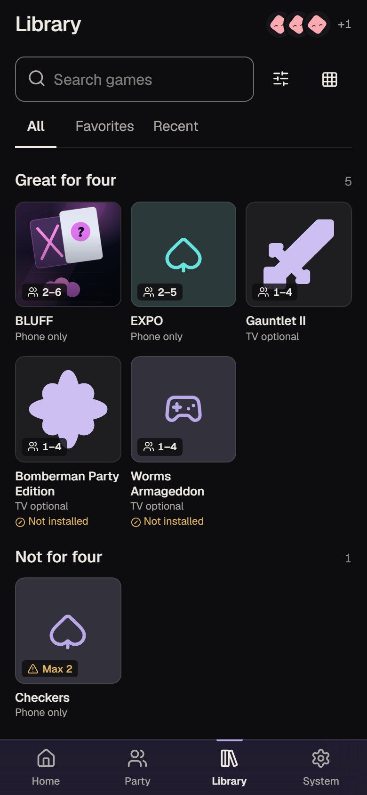 | 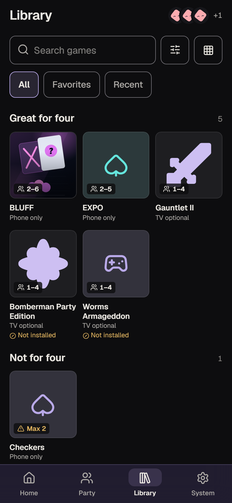 |
| Filters, phone | 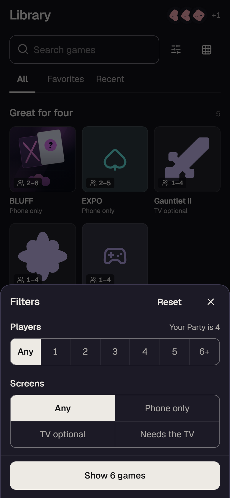 | 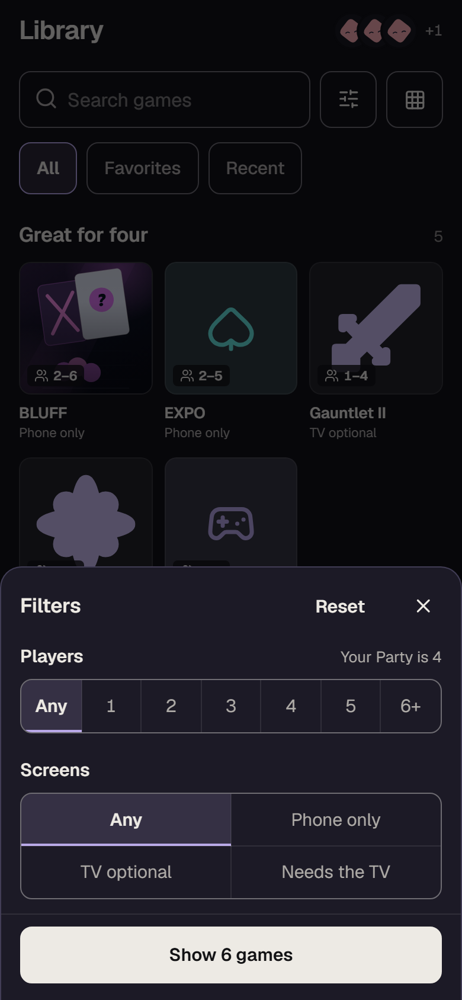 |
| Game list unavailable | 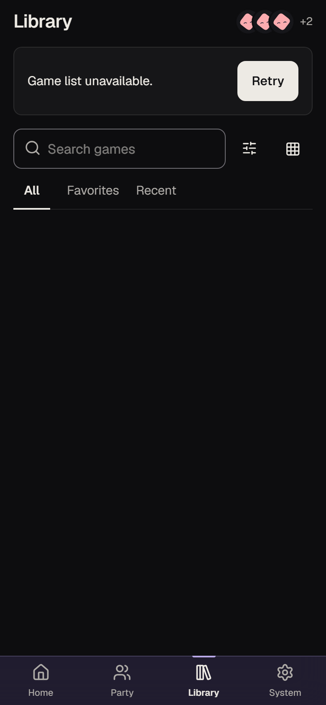 | 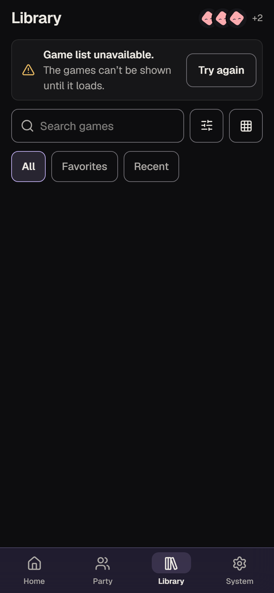 |
| Loading | 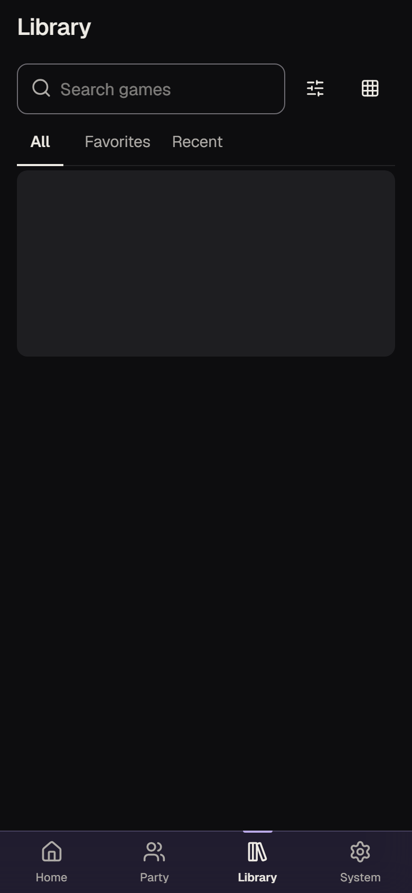 | 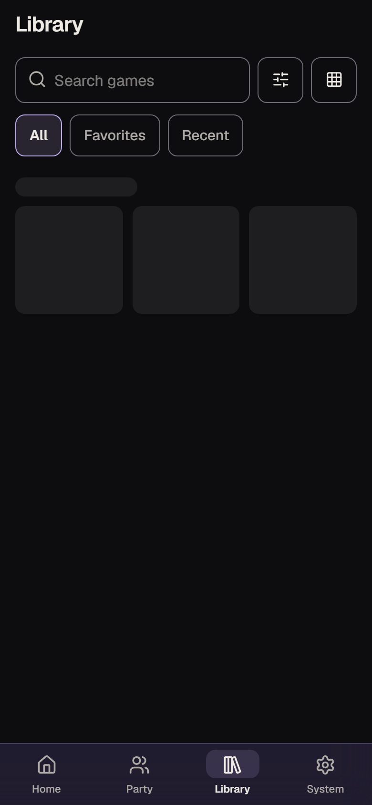 |
| Lost the Party box | 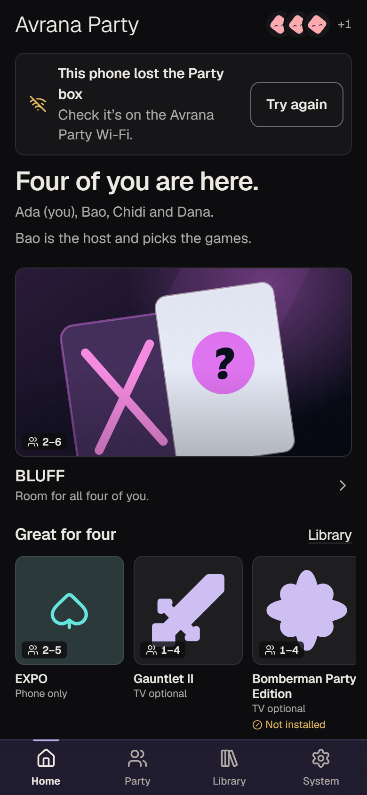 | 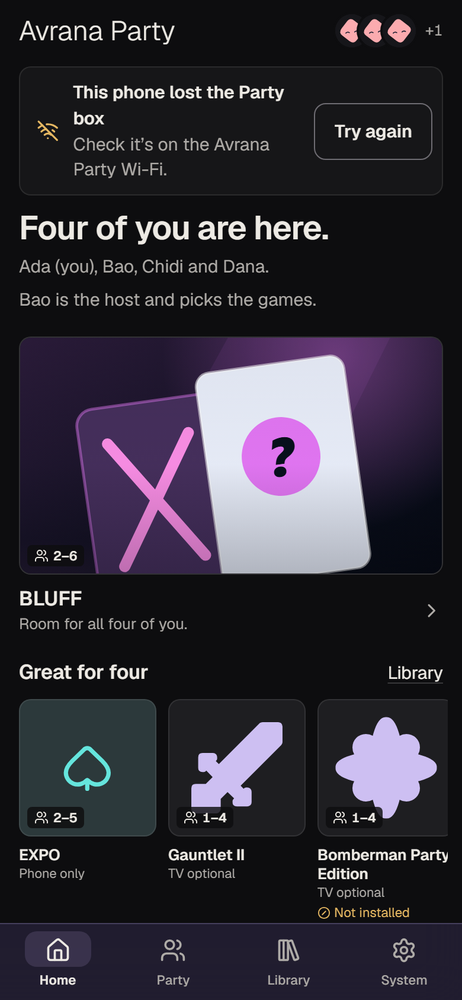 |
| Home, desktop | 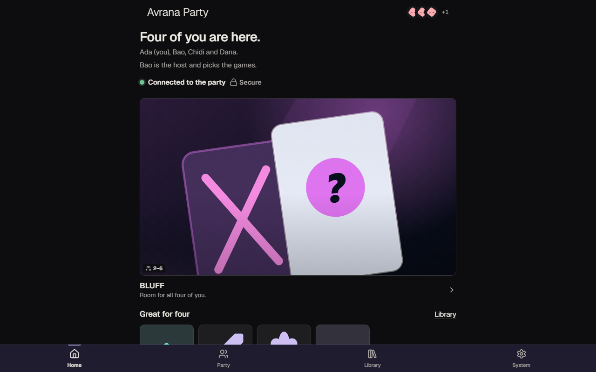 | 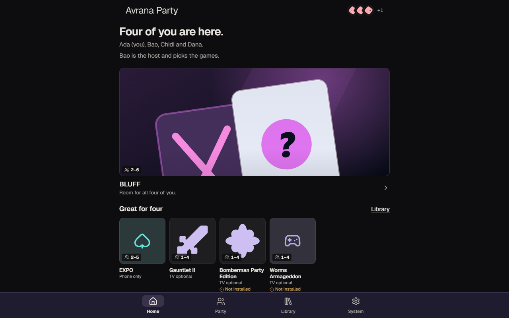 |
| Library, desktop | 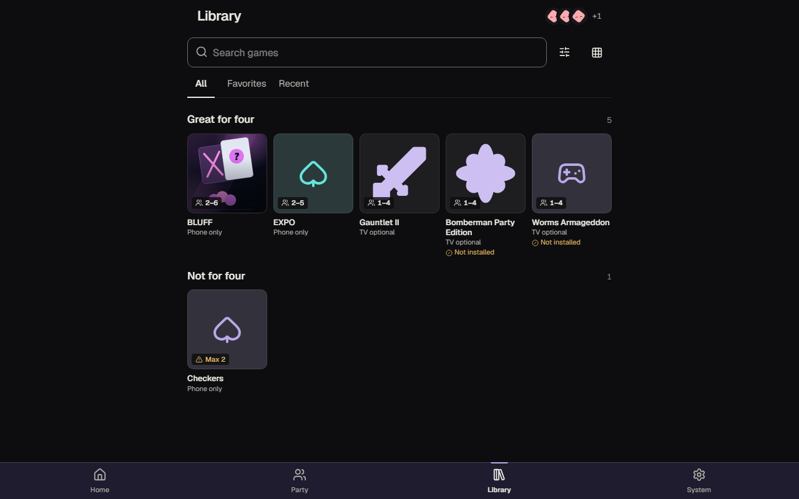 | 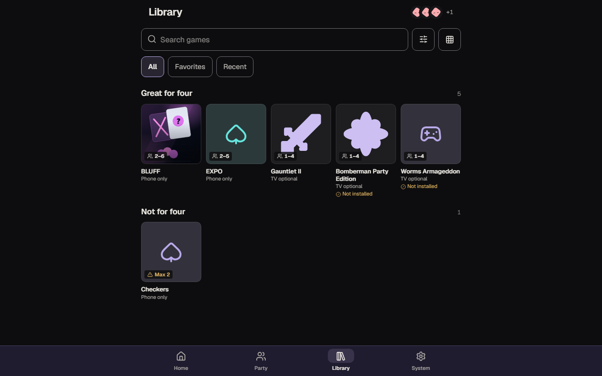 |
| View sheet, desktop | 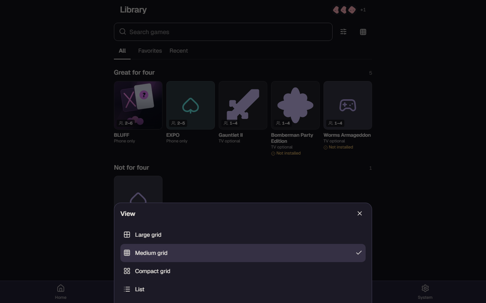 | 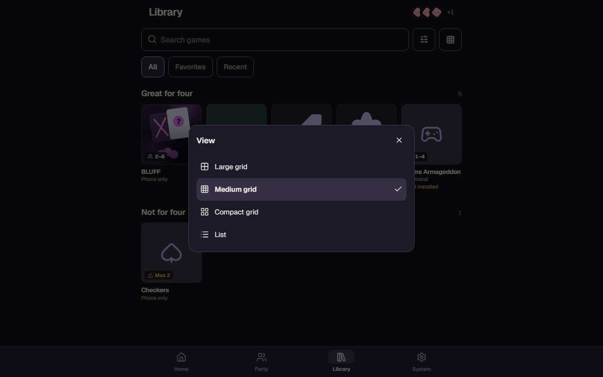 |

The other states (empty search, Reconnecting, filters on desktop) are in `screens/`.

## What changed

| Area | Before | After |
|---|---|---|
| What is chosen | four looks: a line above the nav icon, an underline under a tab, an ink fill in a segment, a tint in a list | one: the Atomic tint, with weight and a mark, on the nav, tabs, segments and choices |
| Navigation | full window width on a desktop, under a 680px column | the four places sit under the column; a tinted mark behind the current icon |
| Library controls | two bare icons beside the search field; underlined tabs | search, Filters and View are one row of edged controls; All, Favorites and Recent are edged words |
| Type | sizes written as numbers in forty places; nine weights | six canonical roles (`caption` to `headline`); weights 400, 500, 600, and 300 for the brand line |
| Recovery | "Retry" as a filled button in its own box; "Try again" elsewhere | one notice: a mark, a bold line, a sentence, "Try again" as an outlined button |
| Notices | three with a coloured stripe down the left | one family: a hairline box, the colour on the icon only |
| How to play | a different dialog (grey, other corners, other button placing) | the same sheet as Filters and View |
| Sheets on a wide screen | stuck to the bottom of the window | a panel in the middle |
| Covers | no answer to a pointer or a press | a stronger edge on hover, a small give when pressed, a clear focus ring |
| Loading the Library | one grey block | the outline of a shelf |
| Lead cover on a wide screen | fills the window; the shelf is below the fold | a band; the shelf is on screen |
| Healthy connection | "Connected to the party" and a padlock on Home | not drawn (still announced); checking, away and Limited Mode are still said |

## Selected defaults and how to revise them

| # | Choice | In source | To revise |
|---|---|---|---|
| 1 | Healthy connection is not drawn on Home | the line is kept for screen readers and hidden from sight when connected, secure and not Limited | delete the `[data-quiet]` rule in `web/src/party.css`; nothing else depends on it |
| 2 | The chosen place has a tinted mark behind its icon | bottom bar | restore the 2px mark above the icon |
| 3 | Sheets and the drawer arrive in 220ms; state changes take 150ms; nothing moves under reduced motion | `--motion-surface`, `--motion-quick`, `--ease-standard` | set the durations to 0 |
| 4 | A chosen segment is tinted, not filled with ink | Filters | restore the ink fill (it then differs from every other chosen thing) |
| 5 | On a wide screen a sheet is a centred panel and the bar is as wide as the column | at 704px and up | remove the two `min-width: 44rem` rules |

Not changed, and still open from the audit: the raised-surface step (`base-200` and `base-300`),
the game page, the briefing, System and the Party page beyond what the shared components carry.
No colour token changed value.

## Kept

Browser only, nothing to install, no build step on the Pi, no remote asset, no inline style, the
service worker shell unchanged (no file was added under `web/party/`), every public contract
untouched, 44px targets, and each state said in words with a mark, never colour alone.
