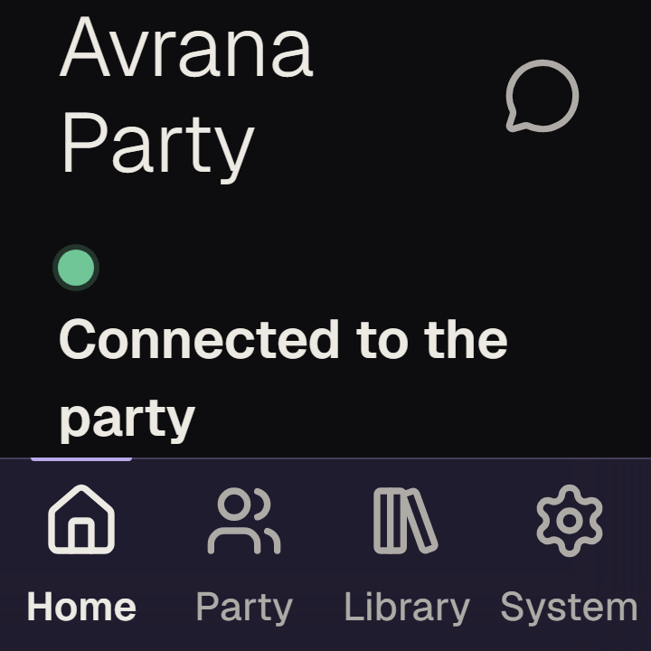
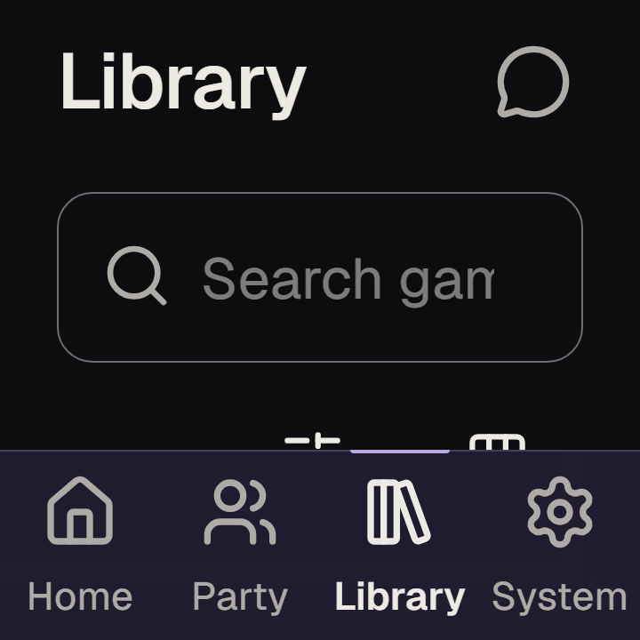

# Small square screens and 200% text: synthetic evidence (AVR-332)

Dated evidence, observed 2026-10-14 (UTC), from `origin/main` at `45fece7`. Historical observation, not a
decision, not a policy. **Synthetic Chromium only: no real handheld, no real panel, no handheld input
hardware, no Safari or Android browser was used, and nothing here claims any of those work.** This change
adds tests and this note; it changes no product UI, CSS or JS (the issue requires owner review before UI
changes merge).

## 1. Method

| What | How |
|---|---|
| Square screens | CSS viewports 480x480 at device pixel ratio 1.5 and 360x360 at DPR 2: what an RG Rotate-like 720x720 physical panel could present, assumed, not measured. Playwright `viewport` + `deviceScaleFactor` on the `android-chromium` (offline) and `phones-chromium` (party) projects |
| 200% text | After load, `document.documentElement.style.setProperty('font-size', '200%', 'important')`. The same lever `tests/offline/a11y.spec.ts` ("How to play") and `tests/party/multi-client.spec.ts` use; it is not an injected `<style>` (the page's CSP refuses one) and it is not browser page zoom or a handheld's own text-size setting. It does double every `rem` (body 15 px to 30 px) |
| Keyboard | Tab, Enter and Escape stand in for a d-pad and buttons. A real device's mapping is untested |
| Offline suite | `tests/offline/square.spec.ts`: 4 conditions x 6 checks over Home, Party, Library, a game's page, System, and three sheets (Library view, Library filter, How to play) |
| Party suite | `tests/party/square.spec.ts`: 4 conditions, two phones (Host, guest): the Host's game page, the briefing, the Play/Watch choice (incl. the first-timer rules that Play opens), How to play, and the Host's controls while a round is on (Party Home "going" panel, reached as `follow-origin.spec.ts` reaches it) |
| Checks | no sideways overflow; primary actions reachable by scrolling and not covered; every visible control reachable by Tab with a focus ring of at least 2 px; hit targets at least 44 CSS px (the party suite's phone selector); sheets keep a button in view, keep Tab inside (focus on `<body>`, the browser's own chrome, is not a leak), close on Escape and do not drop focus; the frame leaves the scrolling middle at least half the viewport |

Helpers reused: `place`, `openGame`, `sideways`, `smallTargets`, `startForEveryone` (`tests/lib/frame.ts`),
`phone` (`tests/lib/phones.ts`, which gained an optional context-options argument). Added to `tests/lib/a11y.ts`:
`tabWalk` and `inReach`. `tabWalk` exists because `focusWalk` ends its walk at the first repeated label, and Home's
"Library" link and the nav's "Library" share one, so `focusWalk` stops after 11 stops on Home and never reaches
the nav's "System" link. That is a limit of the test helper, not a product finding; `tabWalk` tracks element
identity and applies the same ring rule.

The 50% rule in check "the frame leaves room" is a threshold chosen for this note, not a product rule or an
accepted requirement.

## 2. Result

| Check | 480x480 | 360x360 | 480x480, 200% text | 360x360, 200% text |
|---|---|---|---|---|
| No sideways overflow (5 screens) | pass | pass | pass | pass |
| Frame leaves half the screen to the middle | pass | pass | pass | **FAIL (F1)** |
| Primary actions reachable, not covered | pass | pass | pass | pass |
| Hit targets at least 44 px | pass | pass | pass | pass |
| Tab reaches every control, focus ring shown | pass | pass | pass | pass |
| Sheets: in view, no Tab leak, Escape closes | pass | pass | pass | pass |
| Party: game page, briefing, Play/Watch, rules, Host controls | pass | pass | pass | pass |

Only F1 fails. It is held in `tests/offline/square.spec.ts` as `test.fail()` (key
`360x360 at 200% text|room` in `KNOWN`); the suite stays green, and when F1 is fixed that test starts passing,
Playwright reports the now-unexpected pass, and the entry is deleted.

## 3. Findings

### F1. At 360x360 and 200% text the top bar and the nav take 59% of the screen

At 360x360 CSS px with root text at 200%, the frame's two fixed bars leave the scrolling middle 147 px
(Home) to 161 px (Party, Library, a game's page, System) of 360. Top bar 92 to 106 px, nav 107 px. The nav
stays inside the viewport and every control is still reachable by scrolling and by Tab, so this is a
usability cost, not a blocked path: roughly 3 lines of content show at once. In Library the search field
placeholder is cut ("Search gam") and the view/filter buttons are half hidden under the nav until scrolled.

Evidence (synthetic Chromium, 360x360 at DPR 2, 200% text):
`docs/findings/img/avr332-f1-home-360-text200.png` and `docs/findings/img/avr332-f1-library-360-text200.png`.
At the same viewport without 200% text the nav is 54 px and the middle is 260 px (72%); at 480x480 with 200%
text the check passes.




A fix would touch the shell's CSS (compact bars at short heights, or hiding labels). That needs owner review
and is not done here.

## 4. Not covered, untested

- Any real handheld, its screen density, its text-size setting, its d-pad and button mapping, or its browser.
- Browser page zoom (as opposed to root font-size), landscape/non-square sizes, and system high-contrast.
- Screens that are not reachable with existing helpers at these sizes: Limited Mode, the social drawer, Party in
  trouble states (covered at phone sizes by `tests/party/a11y.spec.ts`).
- At 480x480, DPR 1.5, the briefing's Play/Watch buttons end 0.4 px below the viewport before scrolling (the
  bottom hairline touches the edge). `inReach` allows 1 px, so this is not asserted; noted only.

## 5. Commands

```
AVRANA_PYTHON=python AVRANA_DEV_PORT=8391 npx playwright test -c playwright.offline.config.ts tests/offline/square.spec.ts
AVRANA_PYTHON=python AVRANA_PARTY_DEV_PORT=8394 npx playwright test -c playwright.party.config.ts tests/party/square.spec.ts
npm run check:repo
```
