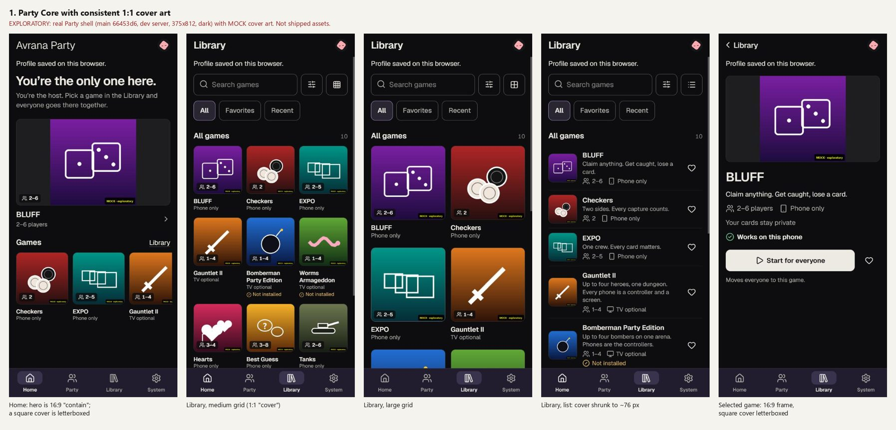
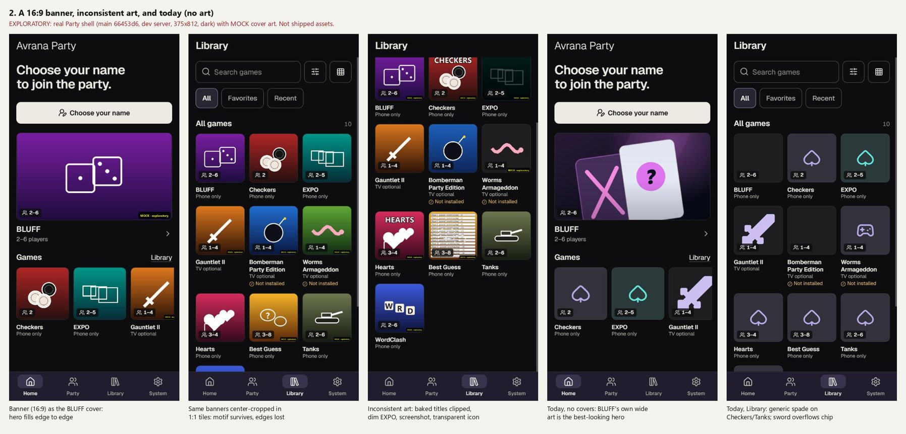

# Party Core with real game artwork: an exploratory visualization

Observed 2026-10-20. **Exploratory.** The real Party shell at Party `main` `66453d6` was run with the dev
server (`--party --covers`), at 375x812 in dark mode, in Chromium on Windows. Every picture in it is
**mock art** made for this note and stamped "MOCK · exploratory". None of it is shipped, committed to
the shell, or a proposed final asset. Four catalog rows (Hearts, Best Guess, Tanks, WordClash) were
added to a local, uncommitted copy of `catalog.json` to show a fuller library. No code changed. This
is separate from the friends field-test release.

The mock covers reach the shell through the owner-cover folder (`covers/`, AVR-306). That is the same
first rung of the cover ladder a package's own cover would use (`web/party/lib/cover-art.js`), so the
frames, crops and fallbacks are exactly what a real cover gets.

## 1. Where artwork appears today

| Surface | Frame | Fit | Source rung |
|---|---|---|---|
| Home, featured game | **16:9** (343x193 on this phone) | `contain` for a cover (shown whole, letterboxed); full-bleed for a title's own wide art (BLUFF's `art/lan-bluff.svg`) | `pickCover`, large |
| Home, "Games" row | **1:1** (116 px) | `cover` (fills, cropped) | `pickCover` |
| Library, compact, medium and large grid | **1:1** (about 90 to 200 px) | `cover` | `pickCover` |
| Library, list row | **1:1** (about 76 px) | `cover`; prefers the package **icon** | `pickCover`, `small` |
| Game page ("selected game") | **16:9** | as the Home feature | `pickCover`, large |
| No picture | the same frames | the kind icon on a tinted tile (`ui.js` `kindIcon`: a spade for any game with private hands, which reads as "card game" on Checkers and Tanks) | last rung |

The package contract already names four images (`docs/design/AVRGAME-PACKAGE.md`, "Bundled artwork"):
- `cover`: 1:1;
- `icon`: 1:1;
- `banner`: 16:9;
- `screenshots`.

The shell serves only cover and icon. Banner and screenshots are validated but not served yet (D11).
Nothing is deployed: on an appliance today a package tile draws its kind icon.

## 2. What the exploration shows

**Shape.** Party Core has two frames, square and 16:9, and no portrait frame.
- A square cover is right for every grid, row and list (board 1).
- The two most prominent places, the Home feature and the game page, are 16:9. A square cover sits there letterboxed between flat grey bars, the weakest-looking state in board 1.
- A 16:9 banner fills them edge to edge (board 2, first frame). BLUFF's own wide art already does this today, and it is the best-looking Home in any capture.
- Portrait box art suits neither frame: centre-cropped in tiles and heavily letterboxed in the wide ones.

**Cover, icon and text.**
- The grid's recognition comes from the art; the decisions come from the text under it (name, player range, "Phone only"). That text stays text, so the art must carry no title.
- At list size (about 76 px) a detailed cover turns into a smudge. A simple icon reads better, which is why the list prefers the icon.
- With no art, every native game with private hands shows the same spade, so Checkers, Hearts and Tanks look alike. A real icon matters more than a cover.

**What breaks when artwork is inconsistent** (board 2, third frame):
- **Baked-in titles** duplicate the name below and are clipped by the crop ("CHECKERS" loses its top).
- **Dark art** vanishes on the dark shell (EXPO, dimmed).
- **A screenshot used as a cover** is noise at tile size, and its text fights the player-range chip.
- **A transparent icon offered as a cover** floats on the tile and looks like a different product.
- **Wide or tall art** is centre-cropped in a square: whatever sits near the edges is lost (the MOCK tag is cut off in the banner set).
- **The player-range chip** always sits bottom-left over the art. Detail there is covered.
- A tile is blank grey while its picture loads (seen on a cold load). Today's shell shows nothing under a loading picture.
- A title's own SVG art can overflow its tile and run into the chip (Gauntlet II's sword, today).

## 3. Recommended artwork contract for first-party adaptations

These are the existing `artwork` slots and limits, with the composition rules the visualization suggests.

**Required**
- **`cover`: 1:1.**
  - Source 1024 px, packed at the existing limits (recommended 512 px, at most 256 KiB, WebP preferred).
  - Opaque. No title, logo or text.
  - One clear subject inside the central 70%.
  - The bottom-left quarter is kept low-detail for the player chip.
  - Legible on the dark shell: a mid-to-light subject, or a lit background.
- **`icon`: 1:1.**
  - 256 px, at most 64 KiB.
  - One simple silhouette that reads at 48 px.
  - Opaque or transparent, with no text.
  - It stands in for the cover in list rows, and wherever a cover is missing.

**Recommended**
- **`banner`: 16:9.**
  - 1280x720, at most 384 KiB.
  - The same subject as the cover, with no text.
  - The subject inside the central square, so the banner survives a square crop if it is ever the only picture.
  - Needed for a polished Home feature and game page. It only shows once the shell serves banners (§4).

**Optional**
- **`screenshots`**: up to 5, with `alt` required. For a future game page, never as a cover.
- **An accent colour** (one hex value) for the loading and no-art tile. This would be a new field and an owner decision; it is not in the contract today.

**Never**
- box art or logos the project has no rights to (a first-party adaptation uses its own art);
- SVG or animated images (the existing contract);
- text in any image.

## 4. Small shell adjustments (documented, not built)

Each is small. None is a redesign, and each needs its own approval.

1. **Wide frames use the banner when there is one.** Add a `banner` rung for the Home feature and the game page, with the square cover as the fallback. This is the step D11 deferred, and it is what makes Home look finished.
2. **Fill the letterbox.** When a square picture sits in a 16:9 frame, fill the bars with a blurred copy of the picture, or with its dominant colour, instead of flat grey.
3. **A placeholder under a loading picture.** Draw the kind icon or the tint under the image, so a slow picture never leaves a blank tile.
4. **A kind icon that doesn't say "cards".** The private-hands spade misleads on Checkers and Tanks; a neutral mark (or the package icon) is better.
5. **Keep title art inside its tile.** The `icon-art` size for Kenney SVGs overflows its tile and collides with the chip in the Library grid.

## 5. Existing games: dedicated menu art now?

**Yes, for the first-party titles, as a small, consistent set**, made outside the frozen field-test release:
- **BLUFF:** already has a good wide piece. Derive a 1:1 cover and an icon from it.
- **EXPO, Checkers, Best Guess:** each needs a cover, an icon and a banner. Today they fall to the kind icon, and a generic spade sells none of them.

The house style is flat and geometric in the brand palette, like `lan-bluff.svg`: one subject, no text. That is cheap to make, consistent, and legible at 48 px.

**Not for the emulated titles** (Gauntlet II, Bomberman, Worms). Their art is the owner's own box art, through the owner-cover folder (never committed). Avrana should not draw art for trademarked games.

**Hearts and later Sprint 04 adaptations** should ship cover and icon in their packages from the start: the kit's scaffold could carry placeholder slots. Placeholder art in a package must be marked as such and replaced before the title is offered as supported.

## 6. Limits of this exploration

- Chromium on Windows at one phone size, in dark mode only. No light mode, no real phone, no TV.
- The art is deliberately simple mock art; it shows frames and failure modes, not a visual direction.
- The four extra catalog rows were local only; those games are not installed or supported.
