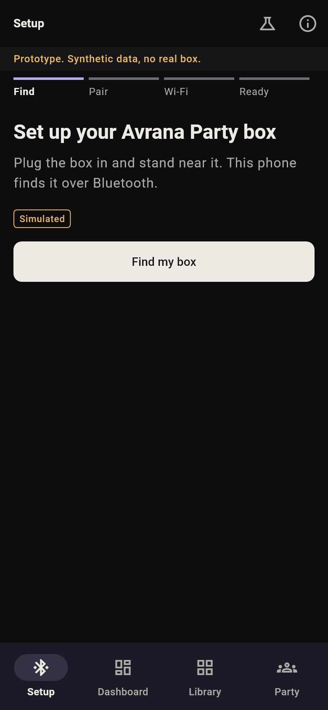
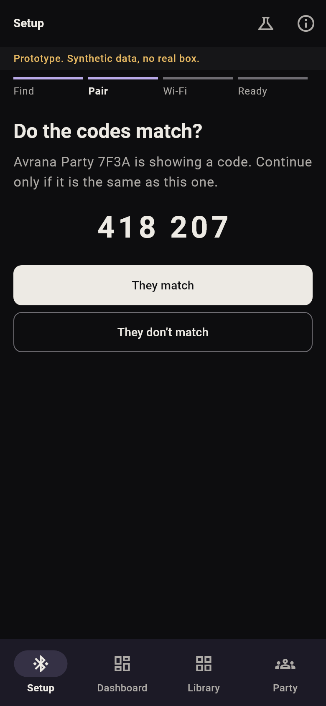
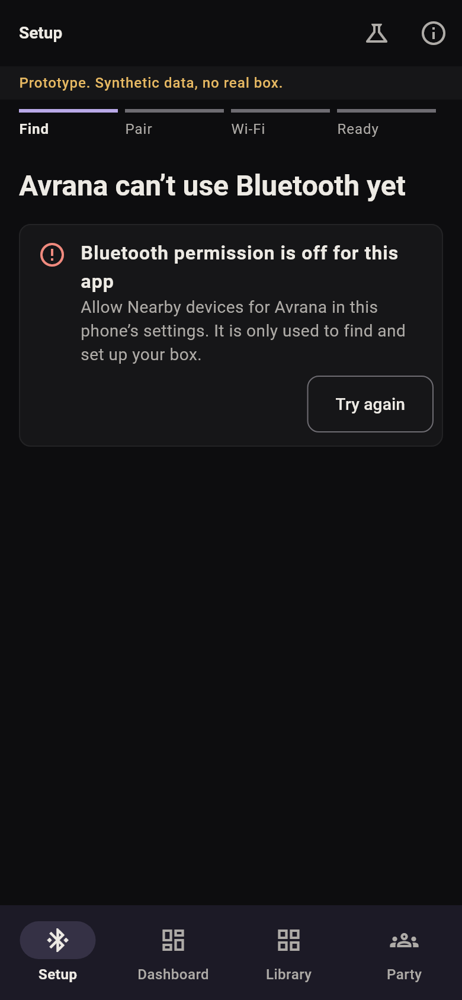
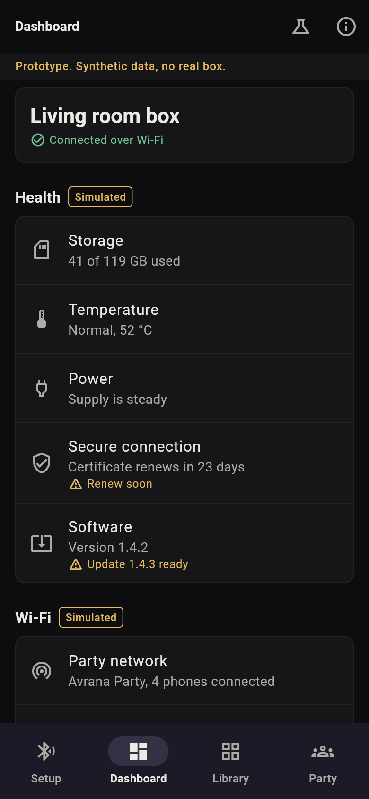
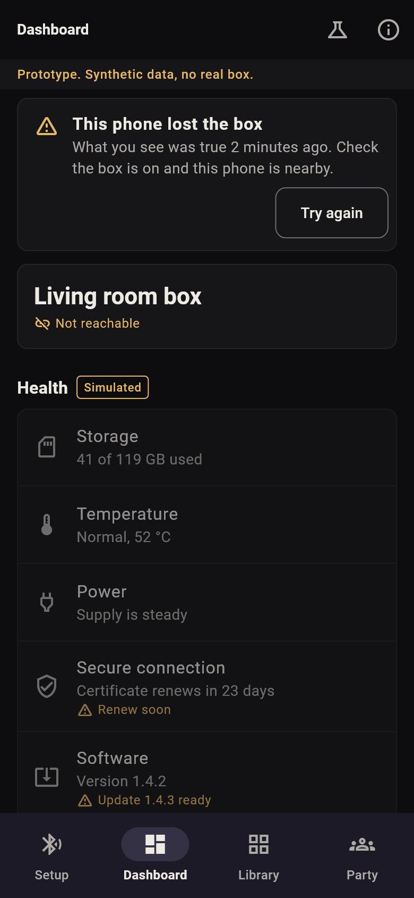
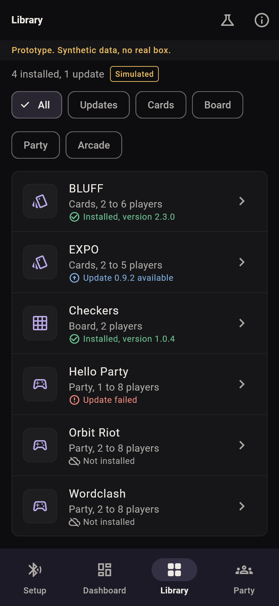
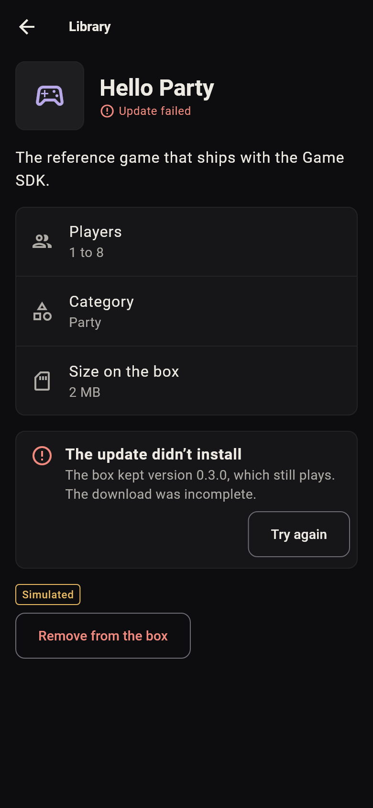
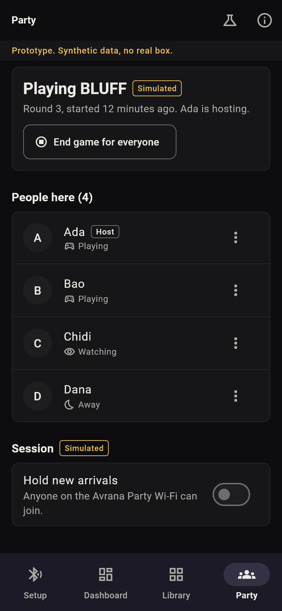

# Owner app prototype (Flutter)

Status: **experiment (2026-10-11, AVR-424). Not production, not an accepted architecture, and not connected to any Party service.**

Four screens of the planned commercial owner app, built with Flutter's Material 3 widgets and
the Avrana Party theme, on synthetic data. It exists to help decide whether Flutter should power
that app; the assessment is the
[feasibility finding](../../docs/findings/2026-10-11-flutter-owner-app-feasibility.md).

## What is real and what is simulated

| Real in this build | Simulated |
|---|---|
| navigation between the four screens (bottom bar on a phone, rail at 600 wide and up) | Bluetooth scanning, discovery and pairing; the pairing code |
| the Avrana Party theme on Material 3 widgets (`lib/theme.dart`) | joining Wi-Fi |
| loading, empty, error and out-of-reach states | every health figure, the software update, certificate renewal, restarting the box |
| the widget tests and accessibility guideline checks | the game list, installs, updates and removals |
| the web build, which loads nothing from another host | the people at the party and every host control |

The app says so itself: a line under the top bar on every screen, a "Simulated" tag beside each
pretend capability, and an "About this prototype" sheet. No plugin, permission, network call or
platform channel is present; `lib/sim.dart` is timers and switches. The flask button in the top
bar switches scenarios (Bluetooth off, permission denied, nothing found, pairing fails, box
unreachable, empty party).

## Run it

Needs the Flutter SDK (built with 3.47.7). From this directory:

```sh
flutter pub get
flutter analyze
flutter test
flutter run -d chrome
```

An offline-capable web build, served from this machine only:

```sh
flutter build web --release --no-web-resources-cdn
python -m http.server 8190 --bind 127.0.0.1 --directory build/web
```

Screenshots of every screen and state (written to `docs/screenshots/`):

```sh
flutter test --update-goldens tool/screenshots_test.dart
```

Android and iOS folders are not committed and were not built: this machine has no Android SDK,
and iOS needs macOS. `flutter create --platforms android,ios .` adds them.

## Screens

| | |
|---|---|
|  |  |
|  |  |
|  |  |
|  |  |

The screenshots come from Flutter's test renderer with Roboto. The product's interface face is
Geist; no TTF of it is in the repository, so type is not final.

## Limits

- Nothing here was run on a phone, with a screen reader, or against a box.
- The party controls (remove a guest, pass hosting) are there to exercise menus and
  confirmations. Who may do either is not decided.
- Fonts in `fonts/` are Roboto (Apache-2.0), copied from the Flutter SDK.
- This code is disposable. Keep the theme mapping and the shape of the tests; write the app new.
